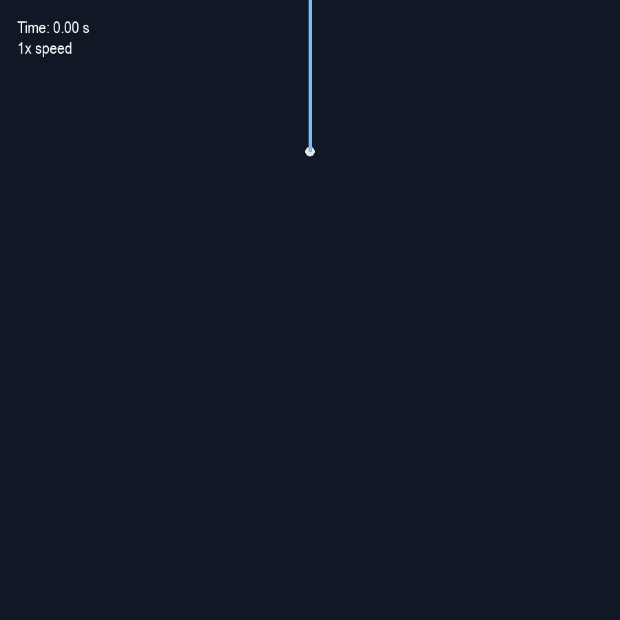
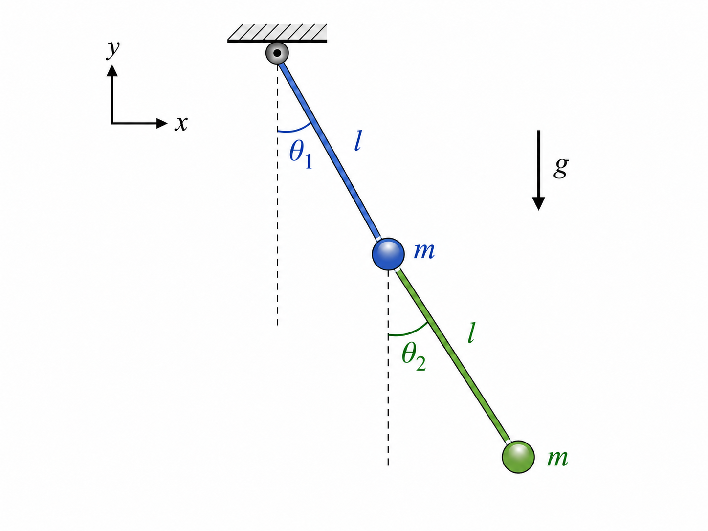

# The-Double-Pendulum

## Demo

<p align="center">
  
</p>

# Introduction

In this project, I created a Python simulation of a nonlinear double pendulum using a second-order Runge-Kutta (RK2) ODE solver. This lets me explore the system's chaotic motion by varying parameters such as timestep, mass, and pendulum length, and observe its total energy and numerical accuracy. I’ve also included an interactive Pygame visualization of the coupled pendulum system.
## Objectives
- Model a nonlinear double pendulum
- Solve the equations of motion numerically
- Investigate chaotic behavior
- Evaluate numerical accuracy
- Visualize the motion

## Physics Model
<p align="center">
  
</p>

The double pendulum is modeled as two point masses, m₁ and m₂, connected by massless rigid rods of lengths l₁ and l₂. The first rod connects the fixed pivot to the first mass, and the second rod connects the first mass to the second mass.

The masses and lengths are constant, positive, and do not need to be equal.

The angular positions are $`\theta_1(t)`$ and $`\theta_2(t)`$, both measured from the downward vertical direction. The corresponding angular velocities are $`\omega_1 = \dot{\theta}_1`$ and $`\omega_2 = \dot{\theta}_2`$.

The model assumes uniform gravitational acceleration $`g`$ and neglects friction and air resistance.

---

## Position of the First Mass

The first mass is located at the end of the first rod. Its Cartesian coordinates are

```math
x_1 = l_1\sin(\theta_1)
```

```math
y_1 = -l_1\cos(\theta_1)
```

Differentiating with respect to time gives the velocity components

```math
\dot{x}_1 = l_1\dot{\theta}_1\cos(\theta_1)
```

and

```math
\dot{y}_1 = l_1\dot{\theta}_1\sin(\theta_1)
```

The squared speed of the first mass is therefore

```math
v_1^2 = \dot{x}_1^2 + \dot{y}_1^2
```

Substituting the velocity components gives

```math
v_1^2 = l_1^2\dot{\theta}_1^2
\left[\cos^2(\theta_1)+\sin^2(\theta_1)\right]
```

Using the trigonometric identity

```math
\cos^2(\theta_1)+\sin^2(\theta_1)=1
```

the squared speed simplifies to

```math
v_1^2 = l_1^2\dot{\theta}_1^2
```

Therefore, the kinetic energy of the first mass is

```math
T_1 = \frac{1}{2}m_1l_1^2\dot{\theta}_1^2
```

---

## Position of the Second Mass

The second mass is attached to the end of the second rod, whose upper end moves with the first mass. Its position therefore depends on both angular coordinates:

```math
x_2 = l_1\sin(\theta_1)+l_2\sin(\theta_2)
```

```math
y_2 = -l_1\cos(\theta_1)-l_2\cos(\theta_2)
```

Differentiating with respect to time gives

```math
\dot{x}_2 =
l_1\dot{\theta}_1\cos(\theta_1)
+l_2\dot{\theta}_2\cos(\theta_2)
```

and

```math
\dot{y}_2 =
l_1\dot{\theta}_1\sin(\theta_1)
+l_2\dot{\theta}_2\sin(\theta_2)
```

The squared speed of the second mass is

```math
v_2^2 = \dot{x}_2^2+\dot{y}_2^2
```

Substituting the velocity components and using the identity

```math
\cos(\theta_1)\cos(\theta_2)
+\sin(\theta_1)\sin(\theta_2)
=\cos(\theta_1-\theta_2)
```

gives

```math
v_2^2 =
l_1^2\dot{\theta}_1^2
+l_2^2\dot{\theta}_2^2
+2l_1l_2\dot{\theta}_1\dot{\theta}_2
\cos(\theta_1-\theta_2)
```
Therefore, the kinetic energy of the second mass is

```math
\begin{aligned}
T_2 &= \frac{1}{2}m_2l_1^2\dot{\theta}_1^2
     + \frac{1}{2}m_2l_2^2\dot{\theta}_2^2 \\
    &\quad + m_2l_1l_2\dot{\theta}_1\dot{\theta}_2
      \cos(\theta_1-\theta_2)
\end{aligned}
```

---

## Total Kinetic Energy

The total kinetic energy of the system is

```math
T = T_1+T_2
```

Combining the kinetic energies of both masses gives

```math
\begin{aligned}
T ={}&
\frac{1}{2}(m_1+m_2)l_1^2\dot{\theta}_1^2
+\frac{1}{2}m_2l_2^2\dot{\theta}_2^2 \\
&+m_2l_1l_2\dot{\theta}_1\dot{\theta}_2
\cos(\theta_1-\theta_2)
\end{aligned}
```

The coefficient $`m_1+m_2`$ appears in the first term because motion of the first rod contributes to the velocities of both masses.

The final term represents the coupling between the two pendulums because the velocity of the second mass depends on the motion of both rods.

---

## Potential Energy

The gravitational potential energy of each mass is determined by its vertical position, with zero potential energy at the height of the fixed pivot.

For the first mass,

```math
V_1 = m_1gy_1
```

Substituting its vertical coordinate gives

```math
V_1 = -m_1gl_1\cos(\theta_1)
```

For the second mass,

```math
V_2 = m_2gy_2
```

which gives

```math
V_2 =
-m_2gl_1\cos(\theta_1)
-m_2gl_2\cos(\theta_2)
```

The total gravitational potential energy is therefore

```math
V = V_1+V_2
```

so

```math
V =
-(m_1+m_2)gl_1\cos(\theta_1)
-m_2gl_2\cos(\theta_2)
```

The coefficient $`m_1+m_2`$ appears in the first term because changing $`\theta_1`$ changes the vertical positions of both masses.

---

## Lagrangian

The dynamics of the double pendulum are described using the Lagrangian

```math
L = T-V
```

Substituting the expressions for kinetic and potential energy gives

```math
\begin{aligned}
L ={}&
\frac{1}{2}(m_1+m_2)l_1^2\dot{\theta}_1^2
+\frac{1}{2}m_2l_2^2\dot{\theta}_2^2 \\
&+m_2l_1l_2\dot{\theta}_1\dot{\theta}_2
\cos(\theta_1-\theta_2) \\
&+(m_1+m_2)gl_1\cos(\theta_1)
+m_2gl_2\cos(\theta_2)
\end{aligned}
```

The equations of motion are obtained using the Euler–Lagrange equation

```math
\frac{d}{dt}
\left(\frac{\partial L}{\partial\dot{\theta}_i}\right)
-\frac{\partial L}{\partial\theta_i}
=0
```

for $`i=1,2`$.

---

## Equations of Motion

Applying the Euler–Lagrange equation to $`\theta_1`$ and dividing by $`l_1`$ gives

```math
\begin{aligned}
&(m_1+m_2)l_1\ddot{\theta}_1
+m_2l_2\ddot{\theta}_2\cos(\theta_1-\theta_2) \\
&\quad
+m_2l_2\dot{\theta}_2^2\sin(\theta_1-\theta_2)
+(m_1+m_2)g\sin(\theta_1)=0.
\end{aligned}
```

Applying the Euler–Lagrange equation to $`\theta_2`$ and dividing by $`m_2l_2`$ gives

```math
\begin{aligned}
&l_2\ddot{\theta}_2
+l_1\ddot{\theta}_1\cos(\theta_1-\theta_2) \\
&\quad
-l_1\dot{\theta}_1^2\sin(\theta_1-\theta_2)
+g\sin(\theta_2)=0.
\end{aligned}
```

These equations are nonlinear and coupled. The angular acceleration of each pendulum depends on the position and motion of the other.

---

## Angular Accelerations for Numerical Integration

For numerical integration, the coupled equations must be solved for $`\ddot{\theta}_1`$ and $`\ddot{\theta}_2`$.

Define the angular difference

```math
\delta = \theta_1-\theta_2
```

and the common mass factor

```math
D = m_1+m_2\sin^2(\delta)
```

Using $`\omega_1=\dot{\theta}_1`$ and $`\omega_2=\dot{\theta}_2`$, the angular acceleration of the first pendulum is

```math
\ddot{\theta}_1 =
\frac{
m_2g\sin(\theta_2)\cos(\delta)
-(m_1+m_2)g\sin(\theta_1)
-m_2\sin(\delta)
\left[l_1\omega_1^2\cos(\delta)+l_2\omega_2^2\right]
}{
l_1D
}
```

The angular acceleration of the second pendulum is

```math
\ddot{\theta}_2 =
\frac{
(m_1+m_2)
\left[
l_1\omega_1^2\sin(\delta)
-g\sin(\theta_2)
+g\sin(\theta_1)\cos(\delta)
\right]
+m_2l_2\omega_2^2\sin(\delta)\cos(\delta)
}{
l_2D
}
```

Because both masses are positive, $`D>0`$ for every angular configuration.

These accelerations define the first-order system

```math
\begin{aligned}
\dot{\theta}_1 &= \omega_1, \\
\dot{\omega}_1 &= \ddot{\theta}_1, \\
\dot{\theta}_2 &= \omega_2, \\
\dot{\omega}_2 &= \ddot{\theta}_2.
\end{aligned}
```

The RK2 midpoint method evaluates this system at the current state to estimate the midpoint state, then evaluates it again at the midpoint to advance the solution by one timestep.

---

## Equal-Mass and Equal-Length Special Case

Setting

```math
m_1=m_2=m,
\qquad
l_1=l_2=l
```

reduces the generalized equations of motion to

```math
2\ddot{\theta}_1
+\ddot{\theta}_2\cos(\theta_1-\theta_2)
+\dot{\theta}_2^2\sin(\theta_1-\theta_2)
+2\frac{g}{l}\sin(\theta_1)
=0
```

and

```math
\ddot{\theta}_2
+\ddot{\theta}_1\cos(\theta_1-\theta_2)
-\dot{\theta}_1^2\sin(\theta_1-\theta_2)
+\frac{g}{l}\sin(\theta_2)
=0
```

Thus, the equal-mass, equal-length model is a special case of the generalized system.

## Numerical Method: Second-Order Runge-Kutta (RK2)

The double pendulum equations of motion form a system of coupled nonlinear ordinary differential equations. Because the equations generally do not have a simple analytical solution, the motion is calculated numerically.

This project uses the **second-order Runge-Kutta midpoint method (RK2)** to propagate the state of the double pendulum through time.

The state vector is

$$
\mathbf{y} = \begin{bmatrix}
\theta_1 \\
\omega_1 \\
\theta_2 \\
\omega_2
\end{bmatrix}
$$

and its time derivative is

$$
\dot{\mathbf{y}} = \begin{bmatrix}
\omega_1 \\
\dot{\omega}_1 \\
\omega_2 \\
\dot{\omega}_2
\end{bmatrix}
$$

where $\dot{\omega}_1$ and $\dot{\omega}_2$ are the angular accelerations obtained from the equations of motion.

---

### Step 1: Evaluate the Current Derivative

At the beginning of each timestep, the derivative of the current state $\mathbf{y}_n$ is calculated:

$$
\dot{\mathbf{y}}_n = \begin{bmatrix}
\omega_{1,n} \\
\dot{\omega}_{1,n} \\
\omega_{2,n} \\
\dot{\omega}_{2,n}
\end{bmatrix}
$$

This represents the instantaneous rate of change of the double pendulum at the beginning of the timestep.

---


### Step 2: Estimate the Midpoint State

The current derivative is used to estimate the state halfway through the timestep:

```math
y_{n+\frac{1}{2}} = y_n + \frac{\Delta t}{2}\,\dot{y}_n
```

where $`\Delta t`$ is the numerical timestep.

This midpoint estimate approximates the state of the double pendulum halfway between $`y_n`$ and $`y_{n+1}`$.

---

### Step 3: Evaluate the Midpoint Derivative

The equations of motion are evaluated again using the midpoint state to obtain

$$
\dot{\mathbf{y}}_{\mathrm{half}} = \begin{bmatrix}
\omega_{1,\mathrm{half}} \\
\dot{\omega}_{1,\mathrm{half}} \\
\omega_{2,\mathrm{half}} \\
\dot{\omega}_{2,\mathrm{half}}
\end{bmatrix}
$$

Because this derivative is evaluated halfway through the interval, it provides a better estimate of the average rate of change over the entire timestep than using only the derivative at the beginning.

---

### Step 4: Update the State

The midpoint derivative is then used to advance the system through the full timestep:

$$
\mathbf{y}_{n+1} = \mathbf{y}_n + \Delta t\,\dot{\mathbf{y}}_{\mathrm{half}}
$$

The complete RK2 midpoint procedure can therefore be summarized as

$$
\dot{\mathbf{y}}_n = \text{derivative evaluated at } \mathbf{y}_n
$$

$$
\mathbf{y}_{\mathrm{half}} = \mathbf{y}_n + \frac{\Delta t}{2}\dot{\mathbf{y}}_n
$$

$$
\dot{\mathbf{y}}_{\mathrm{half}} = \text{derivative evaluated at } \mathbf{y}_{\mathrm{half}}
$$

$$
\mathbf{y}_{n+1} = \mathbf{y}_n + \Delta t\,\dot{\mathbf{y}}_{\mathrm{half}}
$$

---

## Python Implementation

The RK2 midpoint method is implemented as

```python
def move_RK2(f, y, dt):
    ydot = f(y)
    y_half = y + ydot * dt/2
    ydot_half = f(y_half)
    y = y + ydot_half * dt
    return y
```

The variables in the code correspond directly to the mathematical expressions:

* `y` represents the current state $\mathbf{y}_n$.
* `ydot` represents the current derivative $\dot{\mathbf{y}}_n$.
* `y_half` represents the estimated midpoint state $\mathbf{y}_{\mathrm{half}}$.
* `ydot_half` represents the midpoint derivative $\dot{\mathbf{y}}_{\mathrm{half}}$.
* `dt` represents the timestep $\Delta t$.

## Simulation Parameters

The simulation uses a numerical timestep of

$$\Delta t = 0.001\ \text{s}$$

and runs for a total simulated time of

$$t = 30\ \text{s}$$

The initial conditions are

$$\theta_1(0)=\pi,\qquad \omega_1(0)=0$$

$$\theta_2(0)=\frac{\pi}{2},\qquad \omega_2(0)=0$$

The physical parameters used in the model are

- Gravitational acceleration: $g = 9.81\ \text{m/s}^2$
- Pendulum length: $l = 1\ \text{m}$
- Mass of each bob: $m = 2\ \text{kg}$

---

## Why Use RK2?

A basic Euler method advances the state using only the derivative at the beginning of each timestep:

$$\mathbf{y}_{n+1} = \mathbf{y}_n + \Delta t\,\dot{\mathbf{y}}_n$$

The RK2 midpoint method improves this estimate by first calculating an approximate state halfway through the timestep and then using the derivative at that midpoint to advance the system.

For a nonlinear system such as the double pendulum, the state can change significantly during a timestep. Evaluating the derivative at the midpoint provides a more accurate approximation of the system's motion than using only the initial derivative.

---

## Numerical Validation

For an ideal double pendulum without damping, total mechanical energy should remain constant. Because the equations are integrated numerically, a small amount of numerical energy drift is expected.

The simulation calculates kinetic energy, potential energy, and total mechanical energy at every solver timestep:

$$E = T + V$$

The initial total energy is used as the reference value,

$$E_0 = E(0)$$

and the relative energy error is calculated as

$$\epsilon_E(t)=\left|\frac{E(t)-E_0}{E_0}\right|$$

The code plots this quantity over the full 30-second simulation to evaluate the numerical stability of the RK2 solution.

Using the current parameters and a timestep of $\Delta t=0.001\ \text{s}$, the maximum relative energy error over the 30-second simulation is approximately

$$1.58\times10^{-4}$$

or about **0.0158%**.

This small error indicates that the selected timestep provides good energy conservation for the current simulation.

---

## Interactive Visualization

The pendulum motion is displayed using **Pygame** in a $900\times900$ pixel window.

The animation converts the simulated angular positions into Cartesian coordinates for both masses and displays:

- Both pendulum rods and masses
- A motion trail following the second mass
- The current simulation time
- The current playback speed or paused status

The numerical solver uses a timestep of $0.001$ seconds, while the visualization displays every 10th solver point. This corresponds to

$$0.01\ \text{s}$$

of simulated time between displayed animation states at normal speed.

The animation also supports keyboard controls:

- **Space** — pause or resume the animation
- **R** — restart the animation and clear the motion trail
- **Up Arrow** — increase playback speed, up to $10\times$
- **Down Arrow** — decrease playback speed, down to $1\times$

The trail stores the most recent 250 displayed positions of the second mass.

---

## Results

The program produces two primary outputs:

1. An interactive Pygame visualization of the double-pendulum motion with playback controls and a trajectory trail.
2. A Matplotlib plot of relative energy error versus time for evaluating numerical energy conservation.

Together, these outputs provide both a visual representation of the nonlinear motion and a numerical check on the accuracy of the RK2 integration.

---

## Technologies

- Python
- NumPy
- Matplotlib
- Pygame

---

## Running the Project

Install the required Python packages:

```bash
python -m pip install numpy matplotlib pygame
```

Then run the simulation:

```bash
python "ProjectCode_with_timer(1).py"
```

The Pygame animation window will open first. After the animation is closed or reaches the end of the simulation, the Matplotlib relative-energy-error plot is displayed.
